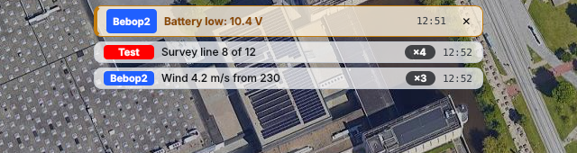
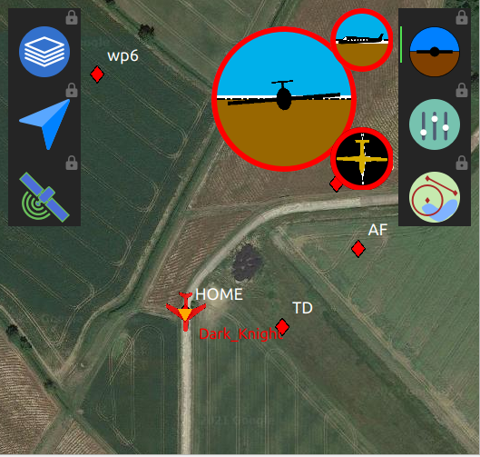
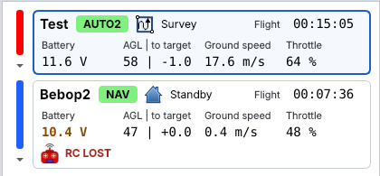
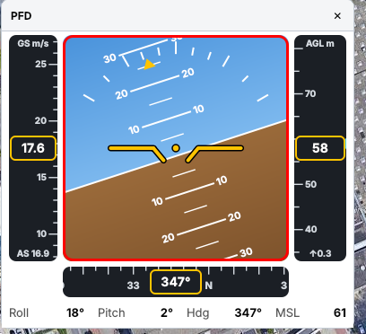
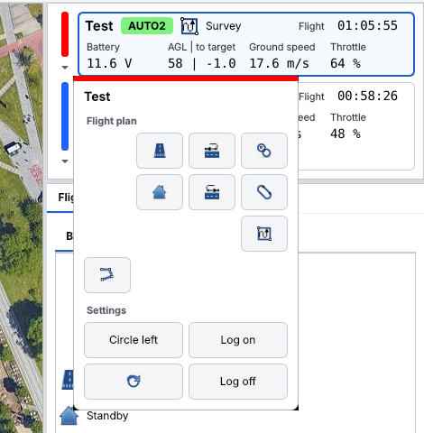
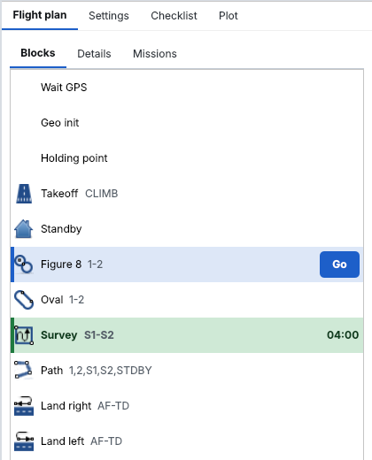
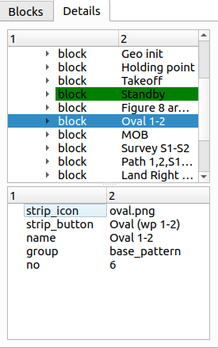
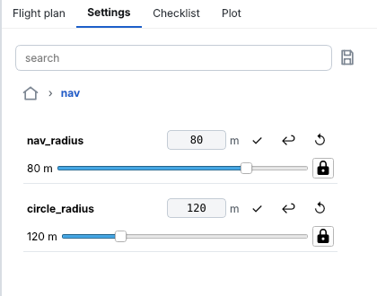
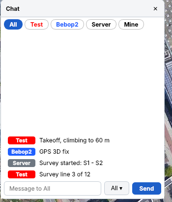
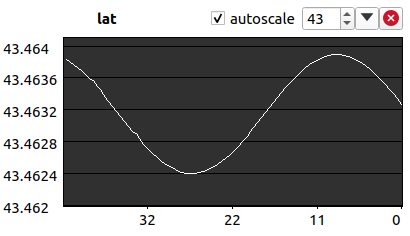

.. developer_guide index_developer

Widgets
=======

There are multiple widgets that you can use. They are described here.

Map 2D
------

name: ``map2d``

This is a classic 2D map to display waypoints and aircrafts.

A telemetry message can be dropped on it to display a papget.

It can be configured to add buttons in a left and right columns to display other widgets over it.
The left column is a rail along the edge of the map: a button opens its widget in a card over the map,
a long press keeps it open, and dragging the button moves the widget (see :ref:`Layout/Tabs <layout_tabs>`).

The cards can be moved over the map by their title bar (double click: back next to the rail) and
resized with the grip in their bottom right corner.

Messages from the aircraft, a low battery and lost links are shown as notifications at the top of the map.
Messages disappear after a few seconds, warnings stay until fixed or dismissed. Click a notification to
select its aircraft and open the chat.

+ Double click an aircraft to select it; with several aircraft their names show (in their color) when the
  pointer is on them or when they overlap. *Aircrafts > Colors* changes the color of an aircraft; aircraft
  with the same configured color get distinct ones.
+ Drag a waypoint to move it: a card next to it shows how far it moved and its height above ground, and its
  old position stays on the map until the aircraft confirms the move.
+ *Map layers* has a brightness slider: a slightly darker map makes the aircraft and waypoints stand out.
+ *File > Settings > General* can show the battery and link icons next to the aircraft.

   map2d, with an overlay widget

Strip
-----

name: ``strips``

Display some data about the drone status.

First row: aircraft name, AP mode, current block and flight time (click the time to show the block or stage time).

Second row, with a caption above each value:

+ battery (amber when low, red when critical)
+ altitude AGL or AMSL (click to change) | altitude difference to the target
+ ground speed / air speed / vertical speed (click to change)
+ throttle

Link, GPS, RC and IMU are only shown when they are not ok. When links are lost the strip gets an amber or red frame.
Click on a strip to select the aircraft for the other widgets, double click it to center the map on it.
With more than 3 aircraft, the strips of the aircraft that are not selected are compact (two lines).
The round icon next to the throttle shows its state: green while the throttle is on, red (and *KILLED*)
while it is killed; clicking it kills or resurrects the throttle, after a confirmation.
Click the battery to show the voltage per cell or the total (with ``BAT_NB_CELLS`` in the airframe).
The link, GPS, RC and IMU icons are shown by default; *File > Settings > General* can hide them when ok.

PFD
---

name: ``PFD``

Primary flight display of the selected aircraft: an attitude indicator (roll and pitch), the ground speed
(air speed below) on the left, the height above ground on the right with a marker at the target height and the
climb rate, the heading below, and the values as text.

Right click on it to choose the view: *pilot view* (the horizon moves, as in an aircraft) or
*ground view* (the horizon stays level and the aircraft symbol banks and pitches, as seen from the ground).

Commands
--------

name: ``commands``

Basic commands, flight plan buttons and setting buttons.

Flight plan
-----------

name: ``flightplan``

Control the flight plan.

The first tab shows the blocks, the current block being highlighted in green with its time.
Tap a block, then *Go*, or double click it to switch to it (amber until the aircraft is in it).

The second tab show the detail of the flight plan, parsed from the XML.
Double click on a block to switch to it.

Settings
--------

name: ``settings``

Aircraft settings, one per line with its control: buttons or a list for named values, a switch for
on/off, a field for a number. Click the name of a setting to open it: the slider for a number, and
*Ask* (the value on the aircraft, asked again after 3 s without answer), *Previous*, *Initial*, *Undo*
and *Send*. A value outside the range is shown in red and sent after a confirmation. A sent value stays
amber until the aircraft confirms it. Search finds settings in all groups; groups with the same name are
shown as one. The save button writes the changed settings into the airframe file.
*File > Settings > General* can show every setting open, as in the old layout.

Chat
----

name: ``chat``

Messages from the aircraft (``INFO_MSG``) and the ground, one row per message with the sender name in its color;
the time is shown on hover. Messages about a problem (low, lost, fail, ...) are highlighted.
With more than one aircraft, a filter shows the messages of one sender.

Plotter
-------

name: ``plotter``

Plot a field of a message.

Switch between plots with menu opened by the arrow down button. You can also add new plots coming from ground messages from there.

Add a plot coming from the telemetry class by dropping a field from the *Messages* tool (same as for the real-time plotter).

+ Zoom on the plot with the mouse wheel.
+ Move the plot up or down by dragging it.
+ Tune the history time with the spinbox
+ Remove the plot with the top right button.

This widget can  be configured from the layout file. See :ref:`Layout/Plotter <layout_plotter>`.

Energy
------

name: ``energy``

The energy left in the battery of the selected aircraft, as the ``energy_mon`` tool of Paparazzi, in % of Wh (not Ah:
the last part of the charge holds less energy, at a lower voltage). Inputs, from ``ENGINE_STATUS``: the voltage, the
current when the aircraft measures it, else the throttle, and the charge used (mAh) when the aircraft counts it.

The voltage of a cell at rest gives its charge through the discharge curve of its chemistry; under load the voltage
sags by ΔV. Pills at the top choose the estimator, from simple to complex, also in flight (the *?* at the top right
explains them):

+ V: the voltage alone (default), which reads low under load but never too high. With a ΔV per cell set in the
  Battery window, the pill reads V + ΔV and the voltage + ΔV is used while the motors run; this is right only when
  the real sag is close to ΔV (a slow fixed wing sags less than a hovering multirotor).
+ mAh: the charge at the start (from the voltage) minus the charge used over the capacity. The charge used is the one
  counted on board (``charge`` of ``ENERGY``), else the current counted by the panel; also when the count of the
  aircraft stays below half of the current it sends (a count that does not count). Needs the capacity.
+ V - I·R: the voltage + 60 % of R x load. R is learned from the changes of the load: each change of current or
  throttle changes the voltage by R x the change; in mΩ per cell with the current, else in mV per % of throttle. Only
  60 % of the sag is corrected, so that the charge left is not overestimated: it reads a little low, but closer than
  the voltage alone. A voltage reading that jumps with the throttle (motor ripple) makes R too high and the estimate
  too optimistic: then use V or mAh. Until the load has changed
  enough, ΔV of the Battery window is used and the panel says so.
+ Filter: the mAh count, pulled slowly (5 min) towards the charge of V - I·R. Needs the capacity, and the current or
  the charge used; else V - I·R is used.

Under the curve: the charge left, the flight time to the reserve, and what the estimator uses: ΔV (V), the mAh used
(mAh), or R (V - I·R, Filter). The time to the reserve comes from the mean power of the last 30 s and the capacity,
else (no current or no capacity) from how fast the energy went down in the last 2 minutes.

The curve: the voltage at rest of the chemistry (black), and under it the curve under load, minus the ΔV of the
estimator (orange; none for mAh), with the battery on it: at rest on the black curve, under load below it, and the
reserve in red.

The battery, which changes seldom, is set in a window (click *Battery...* on the battery line, or right click): the
chemistry (LiPo, LiHV, Li-ion or LiFe; on the flat curve of LiFe the voltage says little about the charge), the cells
in series, the capacity in mAh, the reserve and ΔV under load per cell. The cells and the capacity start from the
airframe (``BAT_NB_CELLS``, ``MAX_BAT_CAPACITY`` in mAh); without ``BAT_NB_CELLS`` the cells are guessed from the
first voltage. The mAh count starts again from the voltage only when the aircraft's own count starts again, or
after a reboot (no telemetry for a few seconds) with a nearly full battery (above 90 %); otherwise, use New battery in
the right-click menu. Change the capacity when you use another battery, also in flight: the mAh estimate follows at once;
a button sets it back to the value of the airframe. Right click: the battery window, new battery. The choices are saved per aircraft;
the cells and the capacity only when they differ from the airframe, else they follow the airframe.

Attitude 3D
-----------

name: ``attitude3d``

The attitude of the selected aircraft in 3D, as the ``attitude_viz`` tool of Paparazzi: the estimate as a solid
model and the setpoint as an orange outline (``AHRS_REF_QUAT``), above a ground grid with N, E, S and W, and the
attitude error (the angle between both: green below 10°, orange below 30°, else red). It shows what pitch and roll
hide, e.g. for a tail-sitter, and whether the aircraft follows its setpoint. Without ``AHRS_REF_QUAT`` the estimate
comes from ``ATTITUDE`` or ``ROTORCRAFT_FP``.

By default the view is from behind the aircraft. Drag to turn the view around. Right click: the model (quadrotor,
fixedwing, or tail-sitter: nose up in a hover, saved per aircraft), *Show the setpoint* (off: only the estimate, without
the outline and the error; saved per aircraft) and the view from behind.
