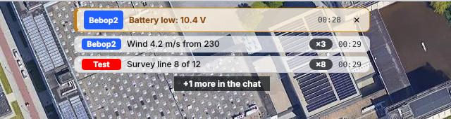
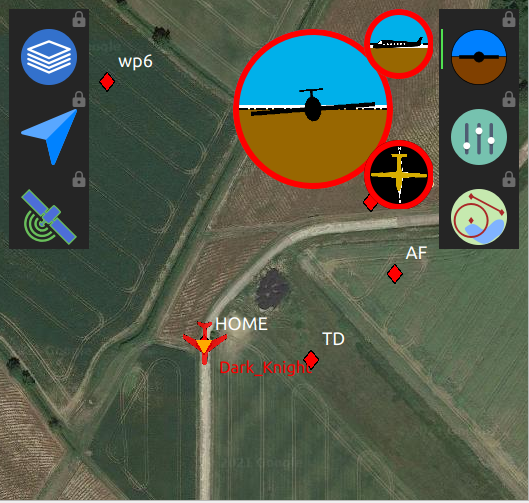
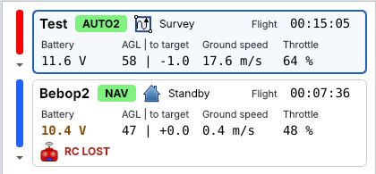
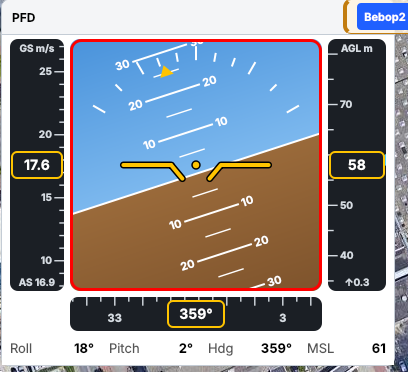
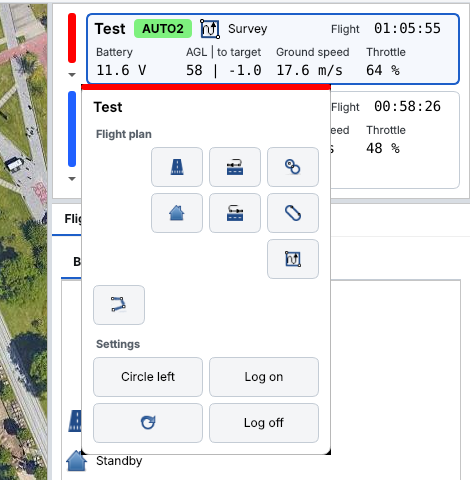
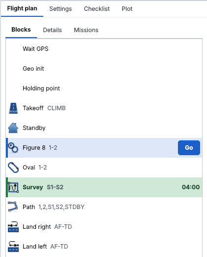
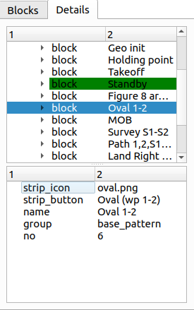
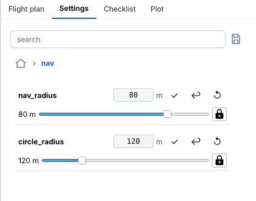
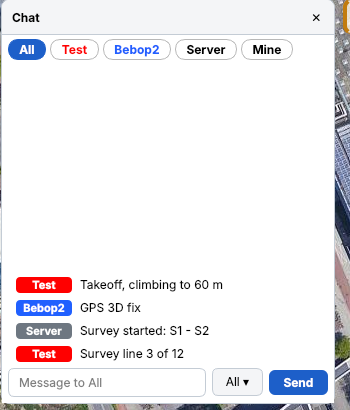
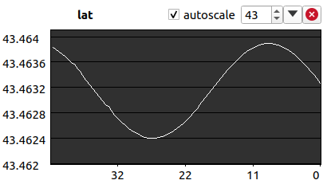

.. developer_guide index_developer

Widgets
=======

There are multiple widgets that you can use. They are described here.

Map 2D
------

name: ``map2d``

This is a classic 2D map to display waypoints and aircrafts.

A telemetry message can be dropped on it to display a papget.

It can be configured to add buttons in a left and right columns to display other widgets over it.
The left column is a rail along the edge of the map: a button opens its widget in a card over the map,
a long press keeps it open, and dragging the button moves the widget (see :ref:`Layout/Tabs <layout_tabs>`).

Messages from the aircraft, a low battery and lost links are shown as notifications at the top of the map.
Messages disappear after a few seconds, warnings stay until fixed or dismissed.

   map2d, with an overlay widget

Strip
-----

name: ``strips``

Display some data about the drone status.

First row: aircraft name, AP mode, current block and flight time (click the time to show the block or stage time).

Second row, with a caption above each value:

+ battery (amber when low, red when critical)
+ altitude AGL or AMSL (click to change) | altitude difference to the target
+ ground speed / air speed / vertical speed (click to change)
+ throttle

Link, GPS, RC and IMU are only shown when they are not ok. When links are lost the strip gets an amber or red frame.
Click on a strip to select the aircraft for the other widgets.

PFD
---

name: ``PFD``

Primary flight display of the selected aircraft: an attitude indicator (roll and pitch), the ground speed
(air speed below) on the left, the height above ground on the right with a marker at the target height and the
climb rate, the heading below, and the values as text.

Commands
--------

name: ``commands``

Basic commands, flight plan buttons and setting buttons.

Flight plan
-----------

name: ``flightplan``

Control the flight plan.

The first tab shows the blocks, the current block being highlighted in green with its time.
Tap a block, then *Go*, to switch to it.

The second tab show the detail of the flight plan, parsed from the XML.
Double click on a block to switch to it.

Settings
--------

name: ``settings``

Aircraft settings. Search finds settings in all groups. A row shows the value on the aircraft and its unit;
a sent value stays amber until the aircraft confirms it. Groups with the same name are shown as one.

Chat
----

name: ``chat``

Messages from the aircraft (``INFO_MSG``) and the ground, one row per message with the sender name in its color;
the time is shown on hover. Messages about a problem (low, lost, fail, ...) are highlighted.
With more than one aircraft, a filter shows the messages of one sender.

Plotter
-------

name: ``plotter``

Plot a field of a message.

Switch between plots with menu opened by the arrow down button. You can also add new plots coming from ground messages from there.

Add a plot coming from the telemetry class by dropping a field from the *Messages* tool (same as for the real-time plotter).

+ Zoom on the plot with the mouse wheel.
+ Move the plot up or down by dragging it.
+ Tune the history time with the spinbox
+ Remove the plot with the top right button.

This widget can  be configured from the layout file. See :ref:`Layout/Plotter <layout_plotter>`.

